<div align="center">




<br/>


<br/>

<a href="https://zionojuwonlo.com"></a>
<a href="https://x.com/withZion_"></a>
<a href="mailto:contact@zionojuwonlo.com"></a>
<!-- Add these when ready:
<a href="https://www.linkedin.com/in/YOUR-HANDLE"></a>
<a href="https://wa.me/234XXXXXXXXXX"></a>
-->

<br/>


<h1>Hey there 👋</h1>

</div>

---

## 🧑‍💻 About Me

```yaml
name:       Zion O'JUWONLO
location:   Lagos, Nigeria 🇳🇬
role:       full stack developer
focus:      systems that watch, decide, act, and report back
domains:    [automation, bots, real-time data, AI-assisted tools]
learning:   [product development, marketing]
leisure:    [reading 📚, chess ♟️, football ⚽]
```

---

## 🛠️ Languages and Tools

<div align="center">

<a href="https://skillicons.dev"></a>

<a href="https://skillicons.dev"></a>

</div>

---

## 🧪 Selected Work

| Project | Stack | What it does |
| :--- | :--- | :--- |
| **Pips Pulse** | `Python` `Cloudflare Workers` `Bots` | Scheduled market intelligence across forex, metals, indices, energies and crypto. Flags opportunities as they form, delivers them to subscribers, and ships with an installable companion app. Every decision is logged, so accuracy is measured rather than claimed. |
| **ScalpGOD** | `JavaScript` `Cloudflare Workers` | Real-time signal engine for 27 crypto perpetuals. Evaluates every pair in parallel on each candle close and gets the result to the user within seconds. |
| **Message Forwarder** | `Python` `FastAPI` `Bots` | Relays messages between groups and channels with per-task filters and text edits, managed from a small web app. Ships self-hosted or in the cloud behind a secure tunnel. |
| **MyPropBuddy** | `Python` `FastAPI` `Claude API` | Conversational advisor that matches traders to the funding program whose rules actually fit them. The model converses; deterministic, tested code makes every recommendation, and every fact carries its source. |

---

## 🔥 My Stats

<div align="center">


<br/><br/>


</div>
